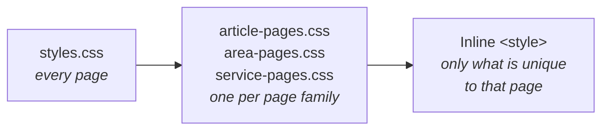
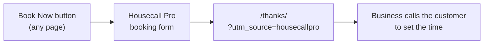

<p align="center">
  <a href="https://www.dryer-ventservices.com">
    
  </a>
</p>

<h1 align="center">Dryer Vent Services</h1>

<p align="center">
  <strong>Cleaning · Repairs · Installations</strong><br>
  Dryer vent specialists based in Staten Island, serving New York and New Jersey.
</p>

<p align="center">
  <a href="https://www.dryer-ventservices.com"><b>Live site</b></a>
  &nbsp;·&nbsp;
  <a href="https://www.dryer-ventservices.com/booking/"><b>Book online</b></a>
  &nbsp;·&nbsp;
  <a href="tel:+13472449382"><b>347-244-9382</b></a>
  &nbsp;·&nbsp;
  <a href="mailto:office@dryer-ventservices.com"><b>office@dryer-ventservices.com</b></a>
</p>

<p align="center">
  <a href="https://github.com/office212/dryer-vent-services-2/actions/workflows/site-checks.yml"></a>
  <a href="https://github.com/office212/dryer-vent-services-2/actions/workflows/update-google-numbers.yml"></a>
</p>

---

This repository is the complete source of **[dryer-ventservices.com](https://www.dryer-ventservices.com)**: a static website of plain HTML, CSS and JavaScript, published by GitHub Pages. There is no build step, no framework and no server code. **Whatever is on `main` is what visitors see.**

## Contents

- [At a glance](#at-a-glance)
- [The business](#the-business)
- [Pages](#pages)
- [How the site is built](#how-the-site-is-built)
- [Design system](#design-system)
- [Images](#images)
- [Booking and contact](#booking-and-contact)
- [Automations](#automations)
- [Analytics and search](#analytics-and-search)
- [Making a change safely](#making-a-change-safely)
- [Keeping this README accurate](#keeping-this-readme-accurate)

## At a glance

| | |
| --- | --- |
| **Live site** | https://www.dryer-ventservices.com |
| **Hosting** | GitHub Pages, custom domain set in [`CNAME`](CNAME) |
| **Stack** | Static HTML, CSS and JavaScript; Google Fonts |
| **Pages** | 58 live pages, plus 9 small redirect pages for old URLs |
| **Booking** | Housecall Pro |
| **Analytics** | Google Analytics 4, `G-X77CVTW1CD` |
| **Publishing** | Merge into `main` → live within a few minutes |

## The business

Dryer Vent Services keeps home dryer vents clear, connected and safe. A blocked or damaged vent dries slowly, wastes energy and raises the risk of overheating and fire, so the site presents the work first as a **safety** service and second as a practical home service: clear the vent, check the full run, fix what is broken, and protect the opening.

It is a **service-area business**: customers are served at their homes, and there is no public street address or walk-in storefront.

### Services

| Service | What it covers | Page |
| --- | --- | --- |
| **Cleaning** | Lint and debris removed from the full vent run, from the dryer to the outside. The core service. | [`/services/cleaning/`](services/cleaning/index.html) |
| **Repairs** | Damaged, disconnected, crushed or poorly routed venting, made secure and correctly connected. | [`/services/repairs/`](services/repairs/index.html) |
| **Installations** | New and replacement vent runs, including the exterior vent termination. | [`/services/installations/`](services/installations/index.html) |
| **Inspection** | Condition and airflow of an existing vent, to decide between cleaning, repair or replacement. | [`/services/inspection/`](services/inspection/index.html) |
| **Bird nest removal** | Nesting material cleared out of the vent so the dryer can exhaust again. | [`/services/bird-nest/`](services/bird-nest/index.html) |
| **Bird guard installation** | A guard over the exterior opening that keeps birds out while letting air through. | [`/services/bird-guard/`](services/bird-guard/index.html) |

### Hours

These match the opening hours published in the site's structured data.

| Day | Hours |
| --- | --- |
| Sunday – Thursday | Open 24 hours |
| Friday | 12:00 AM – 3:00 PM |
| Saturday | 9:30 PM – 12:00 AM |

### Service areas

Staten Island is the home base. The site has a page for each of these 12 areas:

| New York | New Jersey |
| --- | --- |
| Staten Island · Brooklyn · Queens · Five Towns · Monsey · Upstate NY | Clifton · Edison · Fair Lawn · Lakewood · Linden · Teaneck |

## Pages

Every page lives in its own folder as `index.html`, so its address ends in a slash (for example `/about/`). The old `.html` addresses in the root (`about.html`, `gallery.html` …) are tiny redirect pages that send visitors and search engines to the new address. Keep them, because other sites and old bookmarks still link to them.

| Section | Path | Count |
| --- | --- | --- |
| Homepage | [`/`](index.html) | 1 |
| Main pages | `/services/` · `/gallery/` · `/reviews/` · `/faq/` · `/about/` · `/booking/` · `/contact/` · `/areas/` · `/articles/` | 9 |
| Service pages | `/services/<service>/` | 6 |
| Area pages | `/areas/<area>/` | 12 |
| Articles | `/articles/<topic>/` | 28 |
| Thanks page | [`/thanks/`](thanks/index.html), shown after a completed booking; not indexed | 1 |
| Not-found page | [`404.html`](404.html), shown for any missing address | 1 |
| **Total** | | **58** |

<details>
<summary><b>All 28 articles</b></summary>
<br>

`air` · `birds` · `burning-smell` · `clothes-damage` · `condensation` · `diy-trap` · `dryer-sheets` · `energy` · `exterior-signs` · `gas` · `hot-room` · `how-often` · `insurance` · `large-family` · `lint-trap` · `local-advantage` · `moving` · `new-dryers` · `older-homes` · `pets` · `stacked` · `summer` · `thermal-fuse` · `towels-vs-shirts` · `unattended` · `vent-covers` · `warnings` · `winter-hazards`

Each one is at `/articles/<name>/`.
</details>

## How the site is built

### Repository layout

```text
.
├── index.html               Homepage
├── 404.html                 Not-found page
├── <page>/index.html        Main pages: about, areas, articles, booking, contact,
│                            faq, gallery, reviews, services, thanks
├── services/<name>/         6 service pages
├── areas/<name>/            12 area pages        (photos in areas/images/)
├── articles/<name>/         28 articles
├── <page>.html              9 redirect pages for old addresses
│
├── styles.css               Site-wide styles (loaded by every page)
├── article-pages.css        Shared styles for the 28 articles
├── area-pages.css           Shared styles for the 12 area pages
├── service-pages.css        Shared styles for the 6 service pages
├── script.js                Before/after slider, menu, scroll reveal, click tracking
│
├── images/gallery/          Gallery photos, article photos, homepage hero, social preview
├── assets/img/before-after/ Before/after slider photos
├── services/images/         Service page photos
├── logo.webp · logo.png     Logo (WebP, with PNG fallback)
│
├── sitemap.xml · robots.txt Search engine files
├── CNAME                    Custom domain for GitHub Pages
└── .github/workflows/       Site checks and the daily Google rating update
```

### How styles are layered

Each page loads its CSS in this order. A later layer wins over an earlier one, so shared rules live as high up as possible and pages only keep what is truly their own.



- **`styles.css`** holds the whole site's design: header, footer, buttons, mobile menu and components. It ends with a **Site-wide consistency** block that fixes the rules every page must share: the mobile burger menu, the active menu link, the body font, and the hero and spacing of the main pages. Change something there and every page follows.
- **`article-pages.css`, `area-pages.css` and `service-pages.css`** hold the styles a whole family of pages shares. A change to the look of the articles is made **once**, not 28 times.
- **Inline `<style>`** on a page is kept for what really belongs to that page alone: for example, each area page's header photo, or the red warning box on the *burning smell* article. The homepage and the main pages still carry their own inline styles, because each has a unique layout.

### JavaScript

[`script.js`](script.js) is shared by every page:

| Part | What it does |
| --- | --- |
| Conversion tracking | Sends `phone_click` and `whatsapp_click` events to Google Analytics. |
| Before/after slider | The 18 photo pairs on the homepage, booking and gallery pages. WebP, with a JPG fallback. |
| Menu and reveal | The mobile burger menu, and the gentle fade-in of sections while scrolling. |

The gallery's photo list, the back-to-top button and the reading progress bar live in small scripts on the pages that use them.

## Design system

A warm, light, editorial look: ivory backgrounds, deep navy headings and a single strong orange for actions.

### Colors

| Role | Hex | Used for |
| --- | --- | --- |
| **Navy** | `#1B365D` | Headings, brand name, links, page titles |
| **Orange** | `#F47C20` | Buttons, calls to action, small labels, accents |
| **Ivory** | `#FAF7F1` | Page heroes and page backgrounds |
| **Cream** | `#FDF8F0` | Header, mobile menu, soft section backgrounds |
| **White** | `#FFFFFF` | Cards and panels |
| **Hairline** | `#E5DCC9` · `#E8DDD0` | Divider lines and borders |
| **Warm grey** | `#5D574D` | Hero subtitles and body copy on ivory |
| **Active link** | `#F7F9FC` | Light box behind the current page in the desktop menu |

The footer is a light cream gradient with a 4px orange line along its top.

### Fonts

| Font | Role |
| --- | --- |
| **Playfair Display** | Titles, the brand name and the mobile menu. Its real italic is used for the accent word in titles (*Who **We Are***). |
| **Inter** | Body text, desktop navigation, buttons and forms. |
| **Manrope** | The small uppercase labels above titles (for example ABOUT US). |

### Main-page hero

The pages About, Services, Gallery, Reviews, Service Areas, Booking, Contact, FAQ and Articles all open the same way. These values are set once, in the *Site-wide consistency* block of `styles.css`.

| Element | Desktop | Mobile |
| --- | --- | --- |
| Space from the header to the label | 56px | 40px |
| Label | Manrope 12px, bold, orange, uppercase, letter-spacing .22em | same |
| Label → title | 18px | 18px |
| Title | Playfair Display 56px, bold, navy, line-height 1.08 | 38px |
| Title → subtitle | 16px | 16px |
| Subtitle | Inter 18.4px, line-height 1.6, `#5D574D`, max 700px wide | same |
| Subtitle → buttons | 24px | 24px |
| Hero background and bottom line | `#FAF7F1`, 1px `#E5DCC9` | same |
| Hero line → first content below | 60px | 60px |

The 404 and thanks pages use the same title size and navy, and keep their **orange** accent word.

### Shared components

- **Header:** logo, *Dryer Vent Services* in Playfair, and the tagline *Cleaning - Repairs - Installations* ("Cleaning" in orange). The same on every page.
- **Navigation:** Home · Services · Gallery · Reviews · FAQ · Articles · Service Areas · Book Online · About · **Contact Us** (always orange). The current page is bold on a light box (desktop) or bold (mobile).
- **Mobile burger menu:** ivory panel, Playfair links with thin dividers, and an orange Contact Us button. Identical on every page.
- **Mobile action bar:** a floating Book Now · Call · WhatsApp capsule at the bottom of the screen. It is left out on the Contact and thanks pages on purpose.
- **Footer, back-to-top button and reading progress bar:** shared across the site.

## Images

**Every photo is served as WebP, with the original JPG or PNG kept as an automatic fallback.** A page asks for the `.webp`; if it fails to load, the browser switches to the original file with the same name. Header backgrounds do the same with CSS `image-set()`.

| Where | Rule of thumb |
| --- | --- |
| Gallery (`images/gallery/Gallery-*.webp`) | 720px wide. The list of photos, their sizes and captions is at the bottom of [`gallery/index.html`](gallery/index.html). |
| Before/after slider (`assets/img/before-after/`) | 800 × 1200. The slide list is at the top of [`script.js`](script.js). |
| Article previews (`*-thumb.webp`) | About twice their displayed width. |
| Article, area and service photos | Sized to about twice their largest display size. |

When adding an image:

1. Keep the original (`.jpg` or `.png`) and add a `.webp` copy with the same name, in the correct orientation and the **same proportions** as the original. A copy that is off by even one pixel in height can shift the page.
2. Point the page at the `.webp`, with the original as its fallback, like the images already on the site.
3. Give it a real `alt` text that describes what is in the photo, plus `width` and `height`.
4. Leave the social preview (`images/gallery/social-preview.jpg`) and structured-data images as JPG; some apps don't show WebP previews.

## Booking and contact

### Booking (Housecall Pro)



Customers don't pick a date or time online. They leave their details, and the business contacts them to schedule the visit. The booking page, the mobile action bar and the closing sections of each page all lead into this same flow.

### Contact form

The [contact page](contact/index.html) is for questions and quotes that don't need an immediate visit. It asks for full name, email, phone (twice, to catch typos), ZIP, the service needed and a message, and it is protected by **reCAPTCHA**. Messages are sent to a Google Apps Script endpoint, and a successful send is recorded in Google Analytics as `generate_lead`.

## Automations

Two GitHub Actions workflows run on their own. Both are in [`.github/workflows/`](.github/workflows).

| Workflow | When | What it does |
| --- | --- | --- |
| **Site checks** | Every pull request and every push to `main` | Checks every page for broken internal links and images, checks that the JavaScript parses, and checks that `sitemap.xml` and each page's canonical address match the real pages. Read-only. |
| **Update Google review numbers** | Daily at 09:00 UTC, or on demand | Reads the Google rating and review count from the Places API, and updates them on the booking and reviews pages and in every footer, only if they changed. The API key is stored as a repository secret. |

To run the Google update by hand: **Actions** tab → *Update Google review numbers* → **Run workflow** → branch `main`. A green check with no new commit simply means the numbers haven't changed.

## Analytics and search

- **Google Analytics 4**, measurement ID `G-X77CVTW1CD` (property p509604839), installed on all 58 pages. Phone and WhatsApp taps, booking opens and contact-form leads are tracked as events.
- **Structured data:** every page names the same business, with `@id` `https://www.dryer-ventservices.com/#business`, the same name and the same phone. Main pages carry the full `HomeAndConstructionBusiness` entity, service and area pages name it as the `provider`, and articles use `BlogPosting`. The Google rating appears as `AggregateRating` in structured data.
- **`sitemap.xml`** lists the 56 indexable pages. The thanks and 404 pages are excluded on purpose and marked `noindex`.
- Every page has its own title, description and canonical address, and every internal link starts with `/`.

## Making a change safely

`main` is live, so changes go through a branch and a pull request first:

1. **Work on a branch,** never directly on `main`.
2. **Open a pull request.** *Site checks* run automatically and must pass.
3. **Compare before and after.** For anything that touches layout or styles, screenshot the affected pages on `main` and on the branch, desktop and mobile, and compare them. This is how one-pixel shifts and unintended changes are caught before they go live.
4. **Merge.** The site updates within a few minutes. Open it in a private window to skip the browser's cache.
5. **Undo if needed.** Every merged pull request has a **Revert** button on GitHub that restores the site exactly as it was. Nothing is ever lost: every version stays in the history.

Where to make common changes:

| To change… | Edit |
| --- | --- |
| Something on every page (header, footer, buttons, menu) | `styles.css` |
| The look of all articles, area pages or service pages | `article-pages.css` · `area-pages.css` · `service-pages.css` |
| One page's text | That page's `index.html` |
| Gallery photos or captions | The list at the bottom of `gallery/index.html` |
| Before/after slides | The list at the top of `script.js` |
| Pages known to search engines | `sitemap.xml` (the site checks will flag a mismatch) |

## Keeping this README accurate

This README describes the site as it is. When a phone number, email, opening hour, service, area, page, color, font, shared file or tracking ID changes, update the matching section **in the same pull request**, so the repository and the live site never drift apart.

<br>

<p align="center">
  <sub>Dryer Vent Services · Staten Island, New York · <a href="https://www.dryer-ventservices.com">dryer-ventservices.com</a></sub>
</p>
